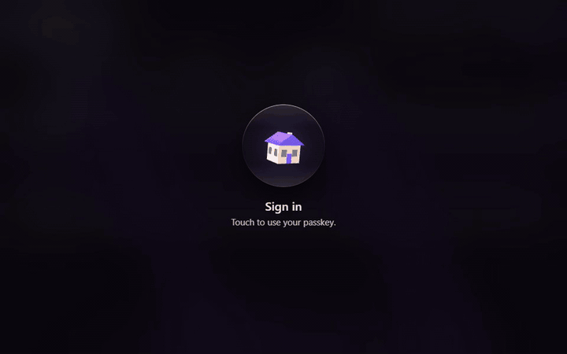

# Swifty Home

**A smart home hub that lives in your house, not in someone's cloud.**

Swifty Home runs your lights, speakers, TV, sockets, air conditioners, pet feeder,
3D printer and home servers from one small program on a machine you own. You open
it in a browser, sign in with a passkey, and tap, say or type what you want.
Swifty, the little bird who lives in the app, listens and helps.

- **One program.** A single binary, `swifty`, with the web app built in. Nothing
  to download at run time, no account to create, nothing phoning home.
- **Passkeys only.** No passwords anywhere. The owner invites the family; family
  members see the lights, music, TV and pets, and nothing else.
- **Careful by design.** The hub starts in *dry-run*: it shows what would happen and
  touches no device until you say `swifty go-live`. Anything with consequences asks
  you to confirm, and anything critical asks for your passkey again.
- **It remembers.** Every action lands in an append-only, hash-chained audit log.
- **Integrations are plugins.** Thirteen ship today, each with a guided setup in the
  app or in the terminal. Writing your own is a documented path.

[](docs/media/swifty-home-tour.mp4)

The whole 70-second tour is [the video](docs/media/swifty-home-tour.mp4); more pictures are in [the demo](docs/demo.md).

> **Status: 0.1.0, young.** Every integration is tested against careful imitations
> of the real devices, and only some have met the real thing. Start in dry-run, then
> check each device by hand while you watch it.

## Try it in five minutes

The quickest way to see Swifty Home is the **demo home**: eight pretend devices
that exist only inside the hub. Nothing real is touched.

### On Linux, with the install script

On a Debian, Ubuntu, Raspberry Pi OS or similar machine (x86_64 or aarch64):

```sh
curl -fsSL https://github.com/gkostadinov/swifty-home/releases/latest/download/install.sh | sh
```

It shows what it is about to do and asks first. Say yes to the demo home and keep
the suggested address, `http://localhost:8790`. When it finishes, it prints a link
with a one-time token. More in [Installing](docs/install.md).

### With Docker

From a checkout of this repository:

```sh
cd packaging/docker
docker compose run --rm swifty-home init --yes --demo --live --origin http://localhost:8790
docker compose up -d
```

### From source, on any computer with Rust

```sh
cargo build --release
./target/release/swifty --config ./demo/swifty.toml init --yes --demo --live --data-dir ./demo/data
./target/release/swifty --config ./demo/swifty.toml serve
```

`--live` lets the demo home answer as a house would. That is safe here because its
devices are pretend and reach nothing; a hub for real devices starts in dry-run.

The first build takes a few minutes. `init` writes everything into `./demo` and
prints a one-time token; `serve` runs the hub until you press Ctrl+C. In a second
terminal you can check that it answers:

```sh
curl http://localhost:8790/healthz
```

### Then, in the browser

1. Open the link `init` printed, or <http://localhost:8790> and paste the token.
   It is good for 15 minutes; `swifty enroll-token` makes a new one.
2. Create your passkey. You are now the owner.
   If you used the install script, the hub is in dry-run and the tiles say "not
   reporting". For the demo home it is safe to turn that off: run
   `sudo swifty go-live`, then `sudo systemctl restart swifty-home`.
3. Look around the demo home: switch the lamp, dim the ceiling light, feed the
   (pretend) cat and see how a consequential action asks you to confirm.
4. Open **More → History** to see every one of those actions written down.

That is Swifty Home. [First run](docs/first-run.md) walks through it slowly, with a
recovery passkey and inviting your family.

## Bringing in your real devices

1. **Make it reachable from your phone.** Passkeys need `https://`, except on
   `http://localhost`. [TLS and the reverse proxy](docs/tls.md) shows three ways,
   from "a name I own" to "home network only".
2. **Add an integration.** In the app: **Integrations → Add**. Or in the terminal:

   ```sh
   sudo swifty plugin add hue
   ```

   Both run the same guided steps: for a Hue Bridge, the address, then "press the
   button on the bridge", then which lights to add.
3. **Go live** when you are ready for commands to reach real devices:

   ```sh
   sudo swifty go-live
   sudo systemctl restart swifty-home
   ```

## What it works with

| Plugin | Devices | Reaches |
| --- | --- | --- |
| `wiz` | WiZ lights | your network (UDP) |
| `hue` | Philips Hue Bridge and its lights | your network |
| `sonos` | Sonos speakers | your network |
| `webos` | LG webOS TVs, with Wake-on-LAN | your network |
| `tuya` | Tuya smart sockets (local protocol 3.3) | your network; Tuya's cloud only to look up keys during setup |
| `toshiba` | Toshiba air conditioners | **Toshiba's cloud, unofficial** |
| `petkit` | Petkit D4 feeder and T4 litter box | **Petkit's cloud, unofficial** |
| `moonraker` | Klipper 3D printers through Moonraker | your network |
| `proxmox` | Proxmox VE hosts and their VMs, with a browser console | your network |
| `plex` | Plex Media Server (is it up?) | your network |
| `camera` | IP cameras (does it answer RTSP?) | your network |
| `glimdock` | [Glimdock](https://github.com/gkostadinov/glimdock) nodes: telemetry and health | your network |
| `mock` | The demo home, and the test double | nothing |

[Integrations](docs/plugins-user.md) says what each one can do and how its setup goes.

**About the two cloud plugins.** Toshiba and Petkit offer no local control and do
not open their clouds to third parties. These plugins talk to the vendors' servers
the way the vendors' own phone apps do. That may be against their terms, and it can
stop working whenever they change something. The app marks them *unofficial*, and
their setup starts by saying so. Use them at your own risk.

## Documentation

| Read this | When you want to |
| --- | --- |
| [Installing](docs/install.md) | install with the script, Docker or from source; uninstall |
| [First run](docs/first-run.md) | create the owner, a recovery passkey, invite the family |
| [TLS and the reverse proxy](docs/tls.md) | open the app from a phone |
| [Integrations](docs/plugins-user.md) | add, set up again and remove devices |
| [Configuration](docs/configuration.md) | understand `swifty.toml` and every `swifty` command |
| [Backups](docs/backup.md) | keep a copy and restore it |
| [Upgrading](docs/upgrade.md) | move to a new version, or from glimdock-home |
| [Security](docs/security.md) | know what protects what, and what does not |
| [Architecture](docs/architecture.md) | see how the hub and its plugins fit together |
| [Roadmap](docs/roadmap.md) | see what is planned next |
| [Packaging](packaging/README.md) | see what each packaging file is for |

Writing a plugin? Start with the [plugin developer kit](docs/plugins/README.md).
Building a client? The API is described in [docs/api](docs/api/README.md).

## Contributing and security

Contributions are welcome: [CONTRIBUTING.md](CONTRIBUTING.md) says how to build, test
and send a change, and [CHANGELOG.md](CHANGELOG.md) says what changed. Please report
security problems privately, as [SECURITY.md](SECURITY.md) describes, and see the
[Code of Conduct](CODE_OF_CONDUCT.md).

## Licence and credits

Swifty Home is licensed under the [Apache License 2.0](LICENSE). [NOTICE](NOTICE)
credits the open-source projects whose protocol knowledge the plugins rely on, and
names the trademarks of the devices it works with. Swifty Home is not affiliated
with any of their makers.

Swifty, the bird, is an original drawing by the project's author. The 3D figure in
the app is drawn in code from it.

A note on the name: a basic web search found no other smart home product called
"Swifty Home". That is not a trademark search and not legal advice.
