# The demo home in pictures

This page shows Swifty Home as it looks, using the **demo home**: eight pretend
devices that exist only inside the hub and reach nothing. Everything below is
from it. To try it yourself, see [Make the demo home yourself](#make-the-demo-home-yourself).

## A one-minute tour

[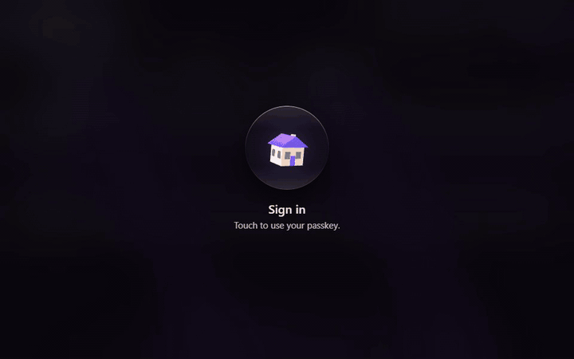](media/swifty-home-tour.mp4)

The picture above is a short loop. [The whole tour](media/swifty-home-tour.mp4) is
71 seconds, with no sound:

| From | What it shows |
| --- | --- |
| 0:02 | Unlocking with a passkey, Home, a light changed, a scene |
| 0:12 | An action that asks you to confirm first |
| 0:22 | Integrations, and what each one reaches |
| 0:30 | Adding the demo integration with the setup wizard, and its devices appearing |
| 0:51 | Swifty's memory |
| 0:59 | History, and the check of its chain |
| 1:09 | How to start |

## The screens

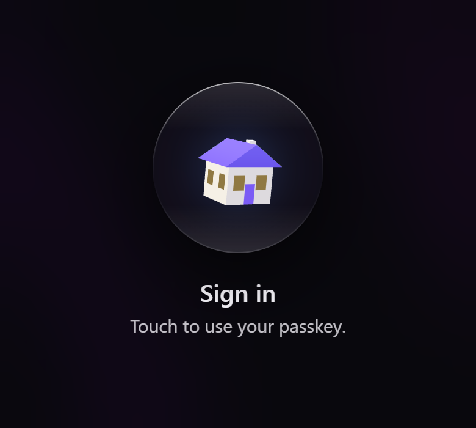

*The lock screen. The house is drawn in 3D by the page itself; one touch of your passkey opens it.*

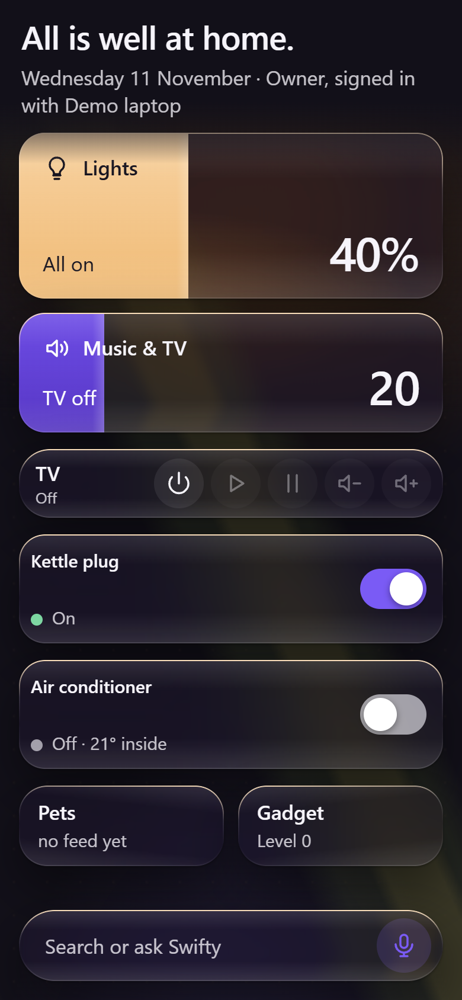

*Home on a phone, in the dark theme: lights, music and TV, sockets, air conditioning and pets.*

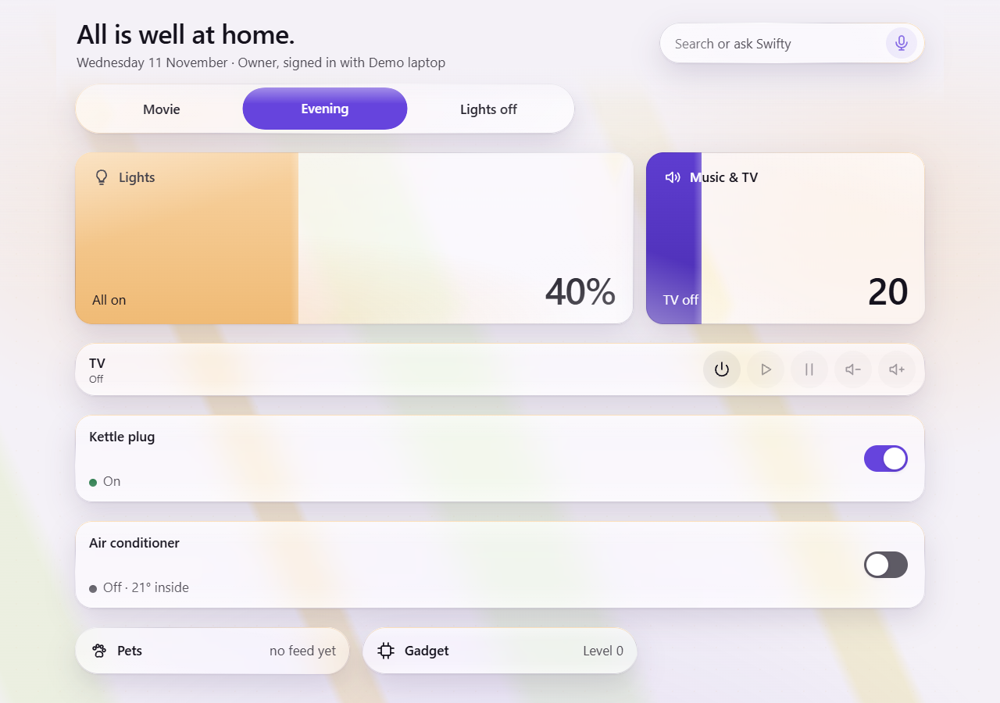

*Home on a desktop, in the light theme, with the Evening scene running.*

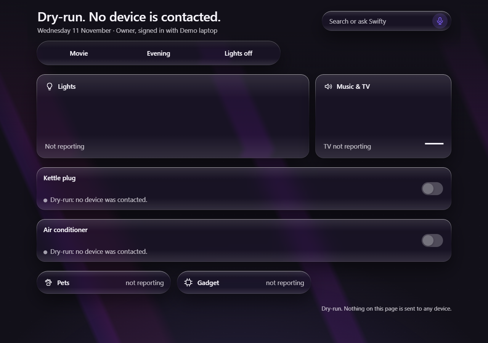

*The same Home right after `swifty init --demo`, in dry-run: nothing is contacted, so the tiles say "not reporting".*

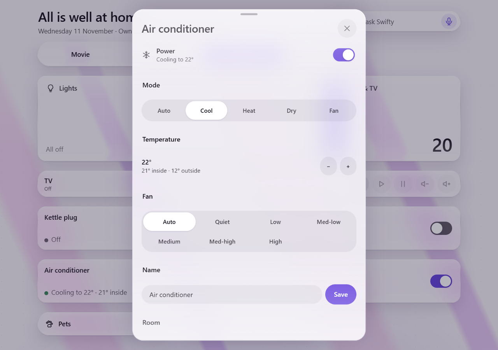

*A device card: the air conditioner, with its own power, mode, temperature and fan controls.*

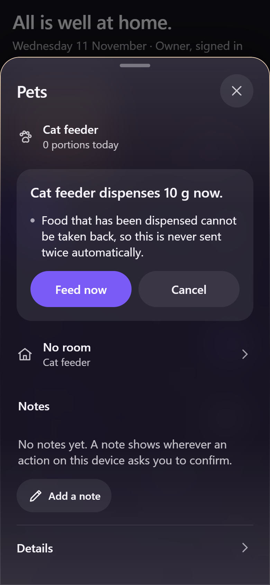

*A consequential action asks first: feeding the cat cannot be taken back.*

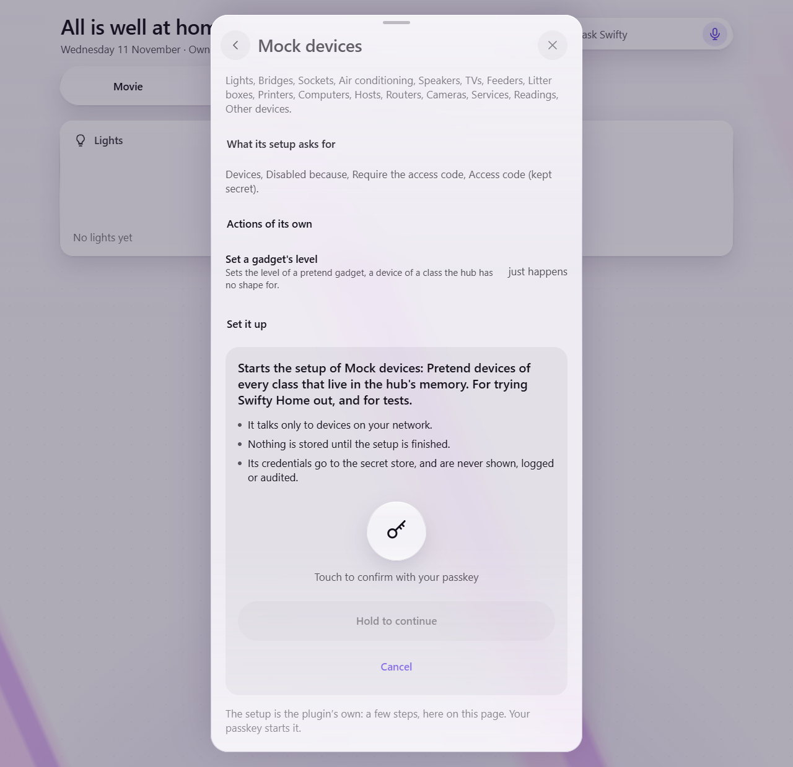

*A critical action asks for your passkey again, then a hold: here, starting an integration's setup.*

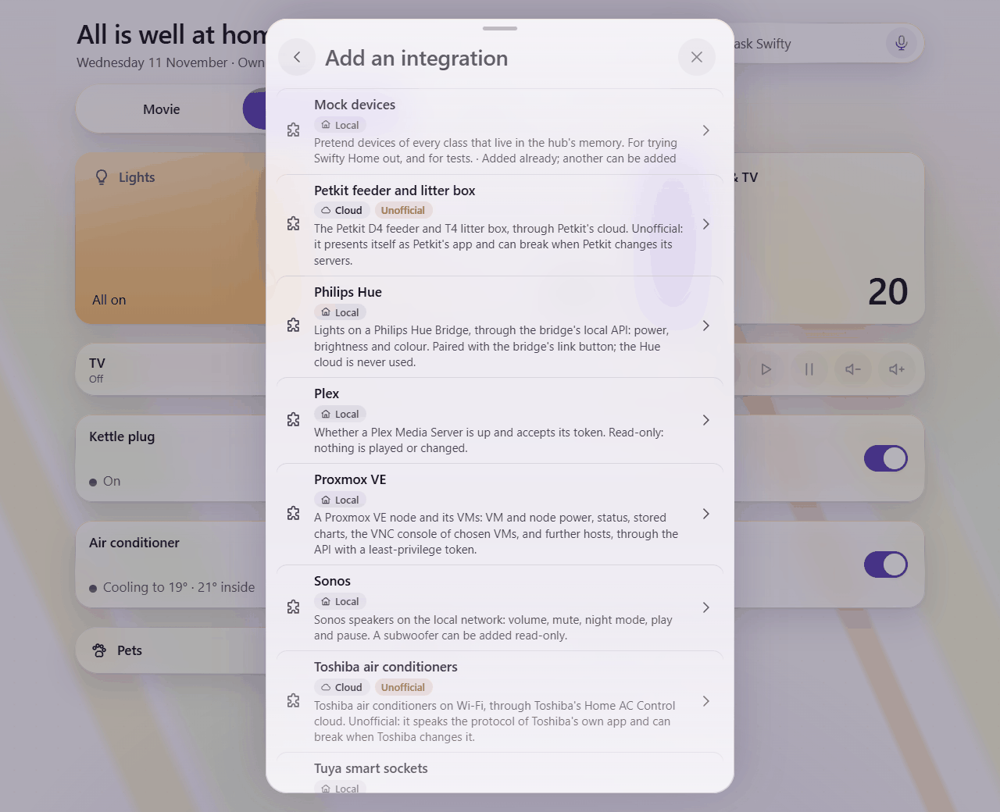

*Adding an integration: each plugin says what it reaches, and the two cloud ones are marked Unofficial.*

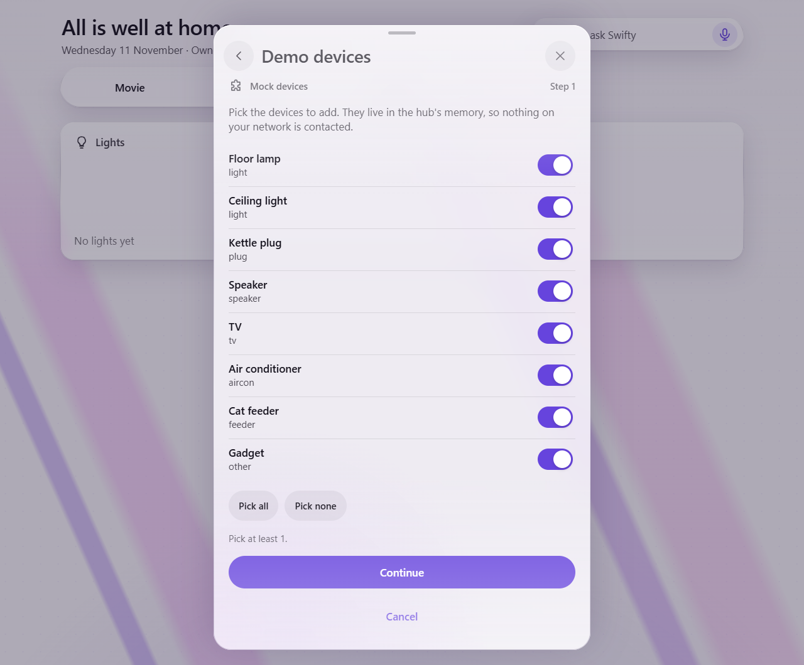

*The setup wizard adding the demo integration: pick which pretend devices to bring in.*

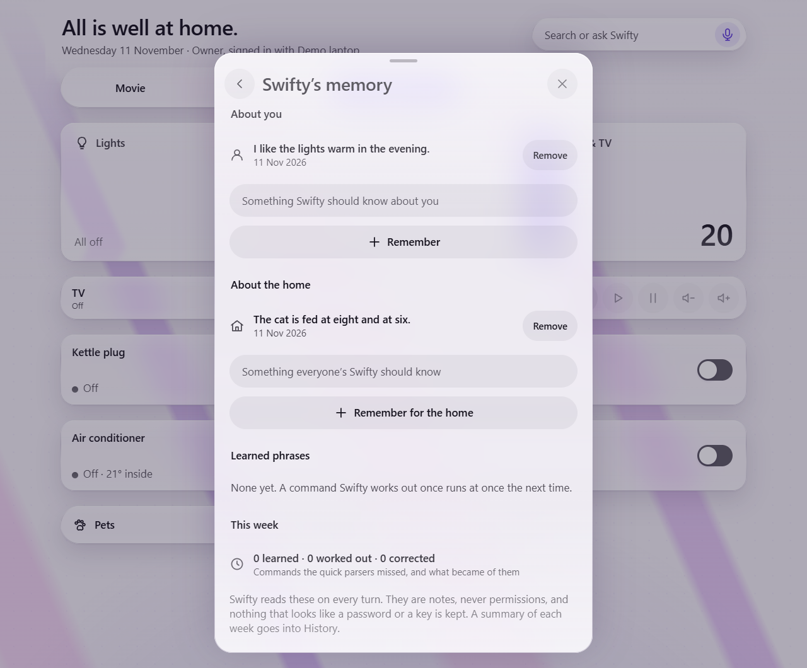

*Swifty's memory: notes about you and about the home. They are notes, never permissions.*

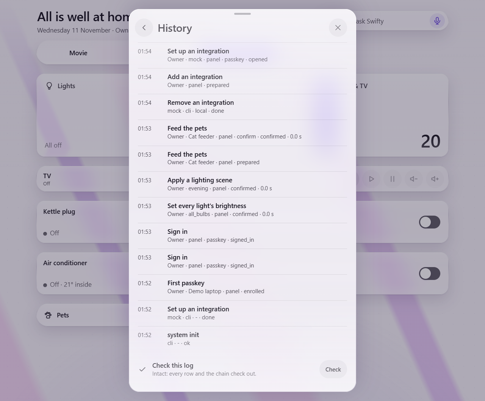

*History: every action written down, and a button that checks the log's chain.*

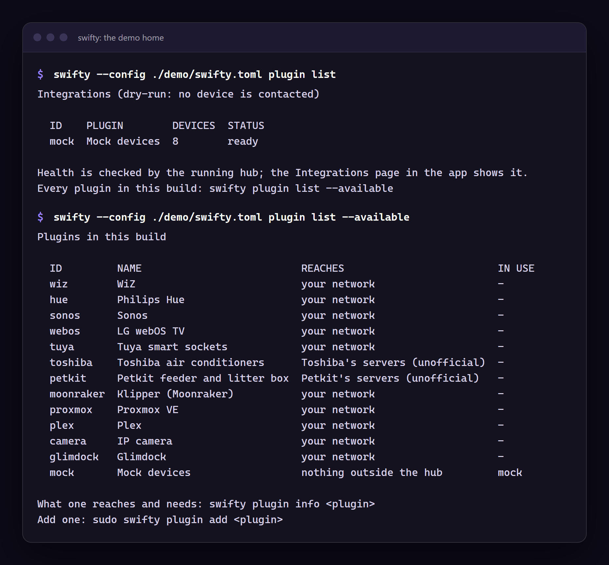

*The terminal: `swifty plugin list` on the demo home, and every plugin in the build.*

## Make the demo home yourself

The demo home takes a few minutes. From a checkout of this repository, with Rust
installed:

```sh
cargo build --release
./target/release/swifty --config ./demo/swifty.toml init --yes --demo --data-dir ./demo/data
./target/release/swifty --config ./demo/swifty.toml serve
```

`init` prints a link with a one-time token; open it, create your passkey, and look
around. [First run](first-run.md) goes through it slowly, and
[Installing](install.md) has the install script and Docker routes.

A hub starts in **dry-run**: it shows what would happen and touches no device, so
the demo home's tiles say "not reporting" and a tap answers "simulated" (the
dry-run picture above). The other pictures show the hub in **live** mode. That is
safe here, because the demo home's only integration is the `mock` one, which has
no connection to anything. To see the same, stop the hub, then:

```sh
./target/release/swifty --config ./demo/swifty.toml go-live
./target/release/swifty --config ./demo/swifty.toml serve
```

`go-dry` takes you back. Do not do this on a hub that has real integrations until
you mean it; see [First run](first-run.md#8-real-devices-then-live-mode).

## How these were made

The pictures and the video were recorded from the demo home in a scripted, headless
Microsoft Edge on one computer, on `localhost`, and nothing else was involved: no real
device, account or data. A virtual passkey stood in for a touch, and the pointer
drawn on the video marks where the script clicked. Swifty's memory page appears only
when a model is configured, so the hub was pointed at a tiny pretend model on
loopback that answers every question with one fixed sentence. The terminal picture
is the real output of the two commands, set in a page. Before the wizard part, the
demo integration was removed with `swifty plugin remove mock`, so that adding it
shows its devices appearing in an empty home (History shows that row, marked `cli`).
The recording scripts are not part of this repository.
